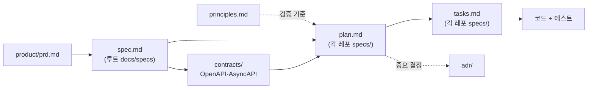

# 문서 지도

| 문서 | 언제 읽나 | 누가 고치나 |
| --- | --- | --- |
| [handoff.md](handoff.md) | 새 컴퓨터·새 세션에서 작업을 이어받을 때 가장 먼저 | 상태가 바뀔 때마다 |
| [principles.md](principles.md) | 모든 plan 작성 전 | 팀 합의 + ADR |
| [product/prd.md](product/prd.md) | 기능을 기획할 때 | PM 역할 |
| [product/glossary.md](product/glossary.md) | 도메인 용어가 헷갈릴 때 | 누구나 |
| [architecture/overview.md](architecture/overview.md) | 전체 구조 파악 | 아키텍처 변경 시 |
| [architecture/service-catalog.md](architecture/service-catalog.md) | 서비스 담당자, 포트, DB 확인 | 서비스 추가·변경 시 |
| [architecture/delivery-and-data.md](architecture/delivery-and-data.md) | 무엇을 어디에 올리고 어떻게 배포·보관·삭제하는지 확인 | 배포 흐름이나 저장 위치가 바뀔 때 |
| [architecture/v4-transition.md](architecture/v4-transition.md) | 아키텍처 v4 전환 작업의 진행 상황 확인 | 작업을 끝낼 때마다 |
| [specs/](specs/README.md) | 기능 구현 전 | 기능 담당자 |
| [contracts/](../service-contracts/README.md) | API·이벤트 연동 시 | 생산자 서비스 담당자 |
| [adr/](adr/README.md) | "왜 이렇게 했지?"가 궁금할 때 | 결정한 사람 |
| [templates/](templates) | 새 문서를 만들 때 | 거의 안 바뀜 |

## SDD 산출물 흐름

