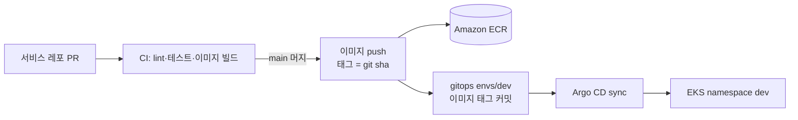

# 배포와 데이터 관리

무엇을 어디서 만들어 어디에 올리고, 어떤 방식으로 버전을 관리하고 지우는지 정리한다. 흐름의 근거는 [overview](overview.md) "환경"·"서비스 배포 흐름"·"데이터 저장", [ADR-0010](../adr/0010-v4-evaluation-readiness.md) ②⑦, [ADR-0011](../adr/0011-derived-data-retention.md), [ADR-0012](../adr/0012-prompt-registry-source.md)다.

상태 표시: `구현` 지금 동작한다 · `로컬` 로컬 compose에서만 동작한다 · `예정` 설계만 있다

## 1. 현재 상태 요약 (2026-11-04)

| 영역 | 상태 | 지금 하는 것 |
| --- | --- | --- |
| 서비스 레포 CI (backend·ai·frontend) | 구현 | PR·main push마다 lint·테스트. 이미지 빌드는 ai CI만 한다(normalize, ai-gateway). backend·frontend는 Dockerfile만 있고 CI에서 빌드하지 않는다. 어느 레포도 이미지를 레지스트리에 올리지 않는다. |
| infra 레포 (AWS) | 예정 | 스택·모듈 폴더(network, eks, ecr, platform-iam, argocd-bootstrap, environment)만 있고 Terraform 코드는 없다. |
| gitops 레포 (클러스터) | 예정 | `apps/`·`envs/dev`·`platform/` 폴더만 있고 매니페스트는 없다. |
| 로컬 환경 | 로컬 | 루트 `local/docker-compose.yml`. 객체 저장소는 SeaweedFS(버킷 `vlm-media`, `vlm-models`) |

운영 배포는 아직 없다. infra·gitops 작업은 지시가 있을 때 진행하고, 그때 이 문서의 `예정` 항목을 채운다.

## 2. 서비스 이미지 배포

| 단계 | 내용 | 상태 |
| --- | --- | --- |
| 빌드 | 레포마다 바뀐 서비스의 이미지를 만든다. backend는 공통 `Dockerfile`, ai는 서비스마다 `services/<service>/Dockerfile`, frontend는 자체 Dockerfile | ai만 구현, backend·frontend 예정 |
| push | main 머지 시 ECR에 `태그 = git sha`로 올린다. 태그는 덮어쓰지 않는다. | 예정 |
| 배포 | CI가 gitops `envs/dev`의 이미지 태그를 갱신하는 커밋을 main에 직접 넣고 Argo CD가 sync한다(루트 `AGENTS.md` Git 규칙의 유일한 직접 커밋 예외). 다른 환경은 태그 갱신 PR | 예정 |
| 되돌리기 | gitops에서 이전 태그로 되돌리는 커밋 | 예정 |
| 인프라 | infra 레포 PR에서 plan → main 머지 → GitHub Environment 승인 → CI가 apply(overview "인프라 변경 흐름") | 예정 |

이미지에는 코드와 의존성만 넣는다. 모델 가중치, Prompt Registry, 프로필은 넣지 않고 기동할 때 받는다(3절). 지금 ai-gateway는 예외로 Prompt Registry와 프로필을 이미지에 넣고 있다(3절 표의 현재 방식).

## 3. 실행 설정과 모델 산출물

이미지와 따로 버전을 관리하고, 서비스가 기동할 때 받아 체크섬을 확인한 뒤에만 `/ready`를 여는 파일들이다. 바꿀 때는 이미지를 다시 배포하지 않고 운영 설정의 버전만 바꿔 재기동한다.

| 대상 | 원본 | 만드는 곳 | 저장 위치 | 버전·검증 | 받는 서비스 | 상태 |
| --- | --- | --- | --- | --- | --- | --- |
| 모델 가중치 (인코더·탐지기·파인튜닝·예측 모델) | 레포 밖(공개 가중치, 학습 작업) | AI 담당자가 업로드 | 모델 버킷 `models/<종류>/<버전>/` + `manifest.json`(파일별 SHA-256·크기, 모델 ID, 차원·클래스, 학습 출처, 라이선스) | 프로필이 manifest 경로와 manifest SHA-256을 가리킨다. 받은 뒤 파일 체크섬 확인 | ai-gateway, frame-encoder, chunk-processor, grounding-worker | 예정(ADR-0010 ②, A-1) |
| ↳ 현재 방식 | 위와 같음 | `local/scripts/upload-models.sh` | 로컬 `vlm-models` 버킷 `open_clip/MobileCLIP2-S0/dfndr2b/open_clip_model.safetensors` | 프로필에 가중치 키와 SHA-256을 직접 적는다. 캐시 `/var/cache/vlm-models/<sha256>/` | ai-gateway | 로컬 |
| Prompt Registry 묶음 (프롬프트, 입력·출력 스키마, 질의 사전, 분류 체계) | ai 레포 `services/ai-gateway/registry/`, 분류 체계는 잠금 파일 버전의 계약 묶음 | ai CI가 main 머지 시 묶음 생성 | 저장소 `registry/<버전>/` + manifest(파일별 체크섬) | 운영 설정(gitops)이 묶음 버전을 가리킨다. 결과에 프롬프트 버전 ID(내용 해시)와 묶음 버전 기록 | ai-gateway | 예정(ADR-0012, A-0·A-2) |
| ↳ 현재 방식 | 위와 같음 | ai CI는 잠금 버전, 로컬은 작업 공간의 계약에서 분류 체계를 가져와 프롬프트와 함께 이미지에 넣음 | 이미지 `/app/registry` | 프롬프트 버전 ID만 기록 | ai-gateway | 구현 |
| ai-gateway 프로필 (taskType별 Adapter·모델·상한, 인코더, 허용 경로·호출자) | ai 레포 `services/ai-gateway/profiles/` | Prompt Registry 묶음과 함께 | 묶음 안 | 묶음 버전 | ai-gateway | 예정(A-2). 지금은 이미지 `/app/profiles`에 넣고 `AI_GATEWAY_PROFILE_PATH`로 고른다 |
| 탐지 프로필 (탐지기 manifest·클래스·`supported_events`) | 형식은 docs `taxonomy/v2/detector-profile.schema.json`, 내용은 AI 담당자 | 사용하는 서비스 spec에서 정함 | 미정 | 프로필 ID·버전, manifest SHA-256 | chunk-processor, grounding-worker | 예정 |

### 쓰기 권한

| 경로 | 쓰는 쪽 | 읽는 쪽 |
| --- | --- | --- |
| `models/` | AI 담당자(이 접두사에만 쓰기 권한) | 모델을 쓰는 서비스(읽기 전용) |
| `registry/` | ai CI | ai-gateway(읽기 전용) |

서비스는 이 경로에 쓰지 않는다. 한 번 올린 버전은 덮어쓰거나 지우지 않는다. 같은 버전 경로의 내용이 바뀌면 체크섬이 맞지 않아 기동에 실패한다.

## 4. 빌드할 때만 쓰는 계약

실행 중에는 읽지 않고 CI의 계약 테스트·코드 생성에 쓴다. 원본은 docs `docs/contracts/`(이후 루트 `service-contracts/`)이고, main에 머지되면 GitHub Release `service-contracts-v<버전>`으로 묶음이 올라간다. 각 레포 CI는 `service-contracts.lock`의 버전을 받아 체크섬을 확인한 뒤 쓴다. 로컬은 작업 공간의 원본을 바로 읽는다([ADR-0013](../adr/0013-service-contracts-release.md)). 지금 docs main을 checkout하는 CI는 잠금 파일로 옮기는 중이다.

| 계약 | 쓰는 곳 |
| --- | --- |
| 이벤트 payload JSON Schema(`events/`) | ai·backend 계약 테스트(발행·소비 메시지가 스키마에 맞는지) |
| OpenAPI(`openapi/`) | Redocly lint·oasdiff, frontend API 타입 생성, 서비스 계약 테스트 |
| AsyncAPI(`asyncapi/`) | 이벤트 채널 문서와 검증 |
| 분류 체계(`taxonomy/`) | 계약 테스트. 실행 중에 쓰는 ai-gateway는 잠금 파일 버전을 Prompt Registry와 합쳐 이미지·묶음에 넣는다(3절) |

## 5. 업무 데이터

### 객체 저장소 (`vlm-media`, 운영 S3 미디어 버킷)

영상 하나의 파일은 모두 `sources/<sourceId>/` 아래에 둔다. 영상을 지우면 이 접두사를 통째로 지운다.

| 경로 | 내용 | 쓰는 서비스 | 상태 |
| --- | --- | --- | --- |
| `sources/<sourceId>/original` | 업로드 원본 | 브라우저(presigned), media-service가 발급 | 구현 |
| `sources/<sourceId>/normalizations/<normalizationId>/normalized.mp4` | 정규화 사본(불변, 재정규화는 새 ID) | normalize | 구현 |
| `sources/<sourceId>/normalizations/<normalizationId>/hls/` | HLS 재생 목록·조각 | normalize | 구현 |
| 구간 대표 프레임(블러 사본), 트랙 크롭, 검출 박스 파일, 근거 프레임 | 분석 산출물 | chunk-processor | 예정(경로는 해당 계약에서) |
| 벡터 파일 | 구간·크롭 벡터(DB 적재 확인 후 30일) | frame-encoder | 예정 |
| 주석 클립 | bbox 주석 클립(30일 미접근 시 지우고 다시 만듦) | grounding-worker | 예정 |
| `queries/<queryId>/` | 이미지로 찾기의 질의 이미지 | search-service | 예정(ai-gateway는 이 패턴만 받음) |

### DB·메시지·캐시

| 대상 | 위치 | 관리 |
| --- | --- | --- |
| 서비스 DB | 서비스마다 하나(auth_db, media_db, pipeline_db, analysis_db, search_db, quality_db, ai_db). 로컬은 PostgreSQL 컨테이너 하나에 DB를 나눔 | 스키마는 Flyway(backend)·Alembic(ai)로만 바꾼다. 다른 서비스 DB에 접근하지 않는다. |
| Kafka | 토픽은 overview "Kafka 토픽" | 보존 30일(`stage.timing` 7일), 별도 아카이브 없음 |
| Redis | rate limit, 알림, 캐시, 분산 락 | 공유 상태 원본이 아니라 앞단 캐시로만 쓴다. |
| Golden Set 확정본 | 별도 버킷(Versioning·Object Lock) | 영구, 삭제 전파 제외 |

### 삭제와 보존

- 영상 삭제(`video.deleted`)를 모든 서비스가 받아 자기 데이터를 지우고, 객체 저장소는 `sources/<sourceId>/` 접두사로 지운다.
- 보존 등급은 [ADR-0011](../adr/0011-derived-data-retention.md)을 따른다. (a) 영상·프레임·크롭·벡터·모델 원문·자유 문장은 바로 지우고, (b) 비식별 파생 데이터는 보존에 동의한 영상만 보존 키로 바꿔 1년 둔다. 보존 데이터는 오프라인 학습 내보내기에만 쓴다.
- 모델 가중치, Prompt Registry 묶음, Golden Set은 영상 삭제와 관계없다.

## 6. 비밀값

| 환경 | 방식 |
| --- | --- |
| 로컬 | `local/.env`(커밋하지 않음). 예시는 `local/.env.example` |
| 운영 | AWS Secrets Manager가 원칙이다. 쓸 수 없으면 Kubernetes Secret으로 넣는다(ADR-0011 보존 키). gitops에 평문 Secret을 커밋하지 않고, Secrets Manager를 쓰게 되면 External Secrets로 같은 Secret을 채운다(`gitops/platform/external-secrets`, 예정). |

## 7. 남은 결정

| 항목 | 정할 때 |
| --- | --- |
| 운영 버킷 이름과 분리(미디어, 모델·registry, Golden Set) | infra 착수 시 |
| Prompt Registry 묶음 버전 형식과 운영 설정 키 | A-2 |
| 탐지 프로필 저장 위치 | chunk-processor·grounding-worker spec |
| 분석 산출물·벡터·주석 클립 경로 규칙 | 각 이벤트 계약 |
