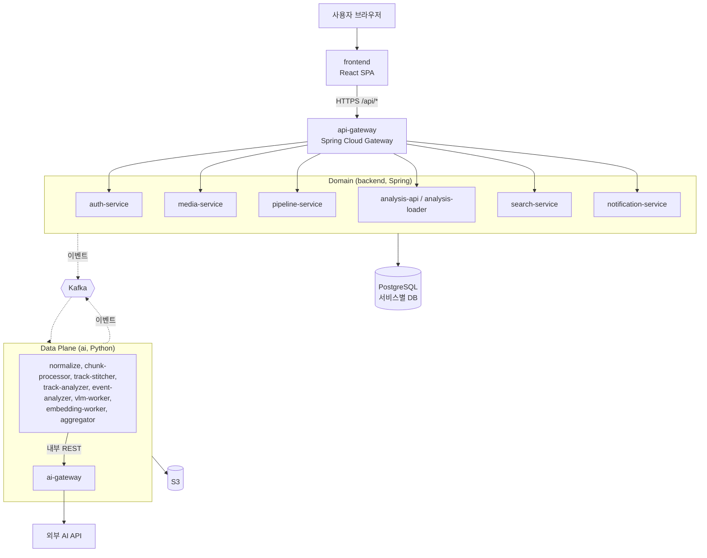
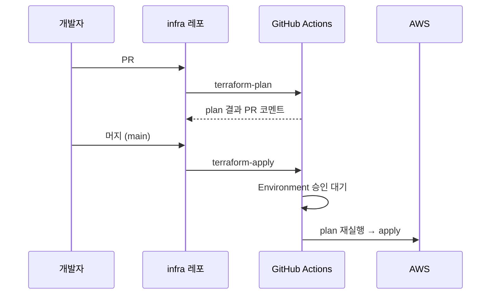
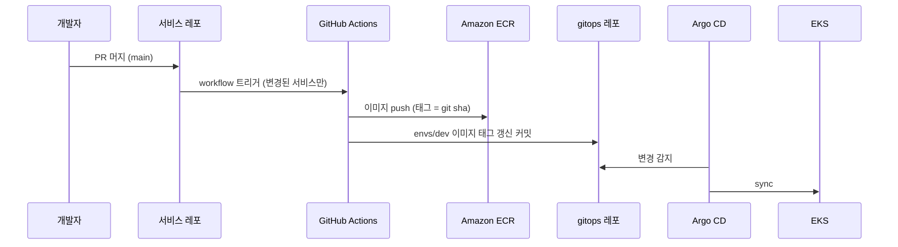

# 아키텍처 개요

> 서비스 목록과 책임은 [service-catalog.md](service-catalog.md)에 있다. 서비스를 바꾸면 둘을 함께 갱신한다.

## 컨테이너 구성 (C4 Level 2)

## 통신 규칙

| 구분 | 방식 | 비고 |
| --- | --- | --- |
| 외부 → 내부 | frontend → api-gateway만 공개 | 각 서비스는 클러스터 내부(ClusterIP)에서만 접근 가능 |
| 인증 | api-gateway에서 JWT 검증 후 사용자 정보를 헤더로 전달 | 각 서비스는 인가만 담당 |
| 동기 호출 | REST(JSON), 타임아웃·재시도·서킷브레이커 필수 | 호출 체인은 최대 2단계 |
| 비동기 | Kafka 이벤트 | 상태 변경은 이벤트로만 전달. [ADR-0002](../adr/0002-kafka-message-broker.md) |
| 서비스 디스커버리 | Kubernetes Service DNS (로컬은 compose 서비스 이름) | Eureka 같은 별도 레지스트리는 쓰지 않음 |

## 환경

EKS 클러스터는 하나이고, 환경은 namespace로 나눈다. 처음에는 dev만 두고, 환경은 infra·gitops 레포의 `_template` 폴더를 복사해 추가한다.

| 환경 | 구성 | 배포 방식 |
| --- | --- | --- |
| local | 루트 `local/docker-compose.yml` | `docker compose up` |
| dev | EKS (namespace `dev`) | 서비스 main 머지 → 이미지 빌드 → gitops 레포 `envs/dev` 태그 갱신 → Argo CD 자동 sync |
| (추가 환경) | EKS (namespace `<env>`) | gitops 레포 `envs/<env>` 태그 갱신 PR → 승인 → Argo CD sync |

## 레포별 책임

| 레포 | 대상 | 반영 방식 |
| --- | --- | --- |
| infra | AWS 리소스 (VPC, EKS, ECR, IAM, Secrets Manager 경로). RDS는 제공받은 것을 조회만 함 | PR에서 plan → main 머지 → GitHub Environment 승인 → CI가 apply |
| gitops | 클러스터 리소스 (Argo CD 자신, 애드온, 서비스, 환경) | PR → main 머지 → Argo CD sync |

## 인프라 변경 흐름 (Terraform)

## 서비스 배포 흐름

