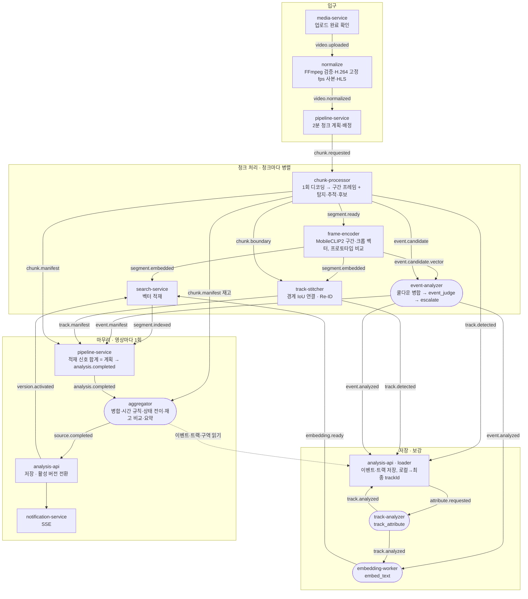

# 업로드 후 처리 순서 (단순판)

> [아키텍처 v5.1](architecture.md) 5절 "업로드 경로"의 단계표를 한 장으로 줄인 문서다. 실시간 경로는 창 이후가 이 표의 5~11단계와 같고 다른 점은 아키텍처 6절에 있다. 영상이 업로드된 뒤 결과가 화면에 나오기까지 어떤 서비스가 무엇을 하고, 어떤 토픽으로 넘기고, 어디서 AI를 부르고, AI 담당자가 바꿀 수 있는 자리가 어디인지만 적는다. 규칙의 근거와 세부 조건은 아키텍처 v5.1과 각 spec에 있다. 두 문서가 다르면 아키텍처 v5.1과 계약이 맞다.

## 1. 한눈에 보기

실선은 Kafka 토픽, 점선은 내부 HTTP다. 둥근 상자는 외부 AI(ai-gateway)를 부르는 단계다.

## 2. 단계별로 무엇을 하는가

| 순서 | 서비스 | 받는 것 | 하는 일 | 내보내는 것 | 기술 | 외부 AI 호출 |
| --- | --- | --- | --- | --- | --- | --- |
| 1 | media-service | 사용자 `/complete` 또는 S3 이벤트 | `UPLOADING → UPLOADED` 조건부 전이. 작업 세션이면 sessionId·역할을 실음 | `video.uploaded` | Spring, Outbox | 없음 |
| 2 | normalize | `video.uploaded` | ffprobe 검증(1초 미만·4시간 초과·스트림 없음은 거절). H.264이고 고정 fps면 복사, 아니면 고정 fps H.264로 재인코딩. HLS 조각 생성 | `video.normalized` | FFmpeg | 없음 |
| 3 | pipeline-service | `video.normalized` | Job·Chunk 계획(기본 2분, 앞뒤 5초 겹침) 저장. 배정기가 사용자별→소스별→전체 한도를 지켜 실행 슬롯과 함께 요청 발행 | `chunk.requested` | Spring, `FOR UPDATE SKIP LOCKED` | 없음 |
| 4 | chunk-processor | `chunk.requested` | 청크를 한 번만 디코딩해 두 갈래로 나눈다. 검색: 10초 창·5초 간격 구간마다 프레임 4장을 뽑아 블러 사본 저장. 이벤트: 확장 범위로 탐지·추적하고 이벤트 정의 목록의 규칙에 맞는 순간을 후보로 묶음(실행당 1건, 후보마다 `judgment: rule` 또는 `vlm`, 근거 프레임 최대 12장). 정적 객체 재고도 기록 | `segment.ready` · `event.candidate` · `track.detected` · `chunk.boundary` · `chunk.manifest` · `chunk.execution.finished` | YOLO26n(COCO) · YOLO-pose(쓰러짐 가상 클래스) · YOLOE(텍스트 클래스: 보호구·화염·연기·방호벽) · ByteTrack, 모두 CPU, 워커 안에서 실행 | 없음 |
| 5 | frame-encoder | `segment.ready` | 구간마다 프레임 4장을 인코딩해 정규화 평균한 벡터 1개, 트랙 대표 크롭 벡터. 벡터 파일을 S3에 저장. 이어서 구간 벡터를 유형별 텍스트 프로토타입과 비교해 임계값 이상이면 벡터 후보 발행 | `segment.embedded` · `event.candidate.vector` | MobileCLIP2-S0(open_clip, CPU), 코사인 유사도 | 없음 (인코더는 워커 안) |
| 6 | search-service | `segment.embedded` | 벡터 파일을 읽어 COPY 적재. `embedding_model`이 활성 설정과 다르면 거절 | `segment.indexed` | pgvector halfvec, HNSW | 없음 |
| 7 | event-analyzer | `event.candidate` · `event.candidate.vector` | 같은 트랙·같은 유형이 10초 안에 이어지면 하나로 병합(메시지 안). `rule` 후보는 템플릿으로 `confirmed`. `vlm` 후보와 벡터 후보는 `event_judge`로 판정하고, 결과가 severity `high`이거나 판단 불가면 `event_judge_escalate`로 재판정. 두 판정이 엇갈리면 `reviewRequired`. 상태형 유형은 메시지 안 구간 규칙(120초)으로 첫 후보만 판정하고 나머지는 결과를 복사(`rule+carry`), 실행당 호출 상한(`max(3, 분당 3회 × 길이)`)을 넘으면 `unverified`(`unverifiedReason: call_cap_reached`). 출력은 `VLMAnalysis` 스키마로 검증. 실패해도 후보를 버리지 않고 `unverified`·`unknown`으로 발행 | `event.analyzed`(후보마다) · `event.manifest`(실행마다, 탐지기 후보만) | asyncio, 동시 4건 | `event_judge`(terra) · `event_judge_escalate`(sol) |
| 8 | track-stitcher | `chunk.boundary` · `segment.embedded` | 인접 청크의 겹치는 5초에서 같은 클래스 트랙을 IoU로 연결. 영상의 모든 청크와 크롭 벡터가 모이면 사라졌다 나타난 트랙을 크롭 벡터 코사인 유사도·시간 간격으로 연결(Re-ID). 로컬→최종 trackId 번역표 저장 | `track.detected`(쌍마다) · `track.manifest`(Job마다) | Redis 대기 상태, 표준 라이브러리 계산 | 없음 |
| 9 | analysis-api · analysis-loader | `event.analyzed` · `track.detected` · `track.manifest` | 이벤트·트랙 저장, 검출 박스 대량 적재, 번역표로 최종 trackId 확정. 이벤트 관련 트랙에 속성 분석 요청 | `attribute.requested` | Spring, 파티션 테이블 | 없음 |
| 10 | track-analyzer | `attribute.requested` | 트랙 대표 크롭 1~3장으로 보호구 착용·역할·장비 추정. 같은 트랙은 결과를 저장해 다시 부르지 않음 | `track.analyzed` | asyncio | `track_attribute`(luna) |
| 11 | embedding-worker | `event.analyzed` · `track.analyzed` · `segment.annotated` | 이벤트 설명문(description·riskReason·solution)과 트랙 설명을 문장 하나씩 텍스트 벡터로 만들어 S3 파일로 저장 | `embedding.ready` → search-service 텍스트 인덱스 | asyncio | `embed_text`(text-embedding-3-small) |
| 12 | pipeline-service | `segment.indexed` · `event.manifest` · `track.manifest` · `chunk.manifest` | 적재 완료 신호의 합이 계획과 맞으면 Job을 `ANALYZED`로. 벡터 후보 판정과 트랙 속성은 완료 조건이 아니다 | `analysis.completed`(counts 포함) | Spring, job 행 잠금 | 없음 |
| 13 | aggregator | `analysis.completed` · `chunk.manifest`(재고) · `event.analyzed`(벡터 후보 대기 집합) · analysis-api 내부 읽기 API | 읽은 이벤트 중 `rule*` 수와 트랙 수가 counts와 다르면 재시도(상한 뒤 `partial`). 대기 집합의 벡터 이벤트를 합친다. (a) 청크 경계에 걸린 같은 사건 병합, (b) 체류 60초·배회 3회/300초 템플릿 이벤트, (c) `confirmed` 이벤트만 시간순으로 훑어 상태 스냅샷과 위험 활성·해소, (d) 노출 지표, (e) 청크별 정적 객체 재고를 시간순 비교해 제거·이동·미복구 후보를 `state_compare`로 판정(Job당 최대 20회), 장비 방치는 템플릿(통로·위험구역이면 `event_judge`), (f) 요약, (g) 영상 끝 활성 위험마다 노출 예측. 세션이 있으면 직전 영상의 마지막 상태에서 시작. 완료 뒤 늦게 온 벡터 이벤트는 그 시각 이후를 다시 계산해 `revision`을 올려 다시 발행 | `source.completed`(결과 파일 경로, revision) | 순수 함수(같은 입력이면 같은 결과) | `state_compare`(terra) · `event_judge`(terra) · `source_summary`(luna, 텍스트만) · `risk_forecast`(predictor, 규칙 점수) |
| 14 | analysis-api → notification-service | `source.completed` | 자기 저장 수가 manifest 수와 맞을 때 같은 트랜잭션에서 규칙 이벤트·스냅샷·위험 상태 저장과 활성 버전 전환. revision이 올라간 재전달은 upsert(생산자 확인 필요). 브라우저에 SSE 알림 | `version.activated` → search-service | Spring, Redis pub/sub | 없음 |

읽을 때 기억할 것

- 모델이 워커 안에서 도는 단계(4, 5, 8)는 ai-gateway를 부르지 않는다. 외부 AI 비용은 7, 10, 11, 13에서만 생긴다.
- 4~11은 청크마다 병렬이고, 12~14는 영상마다 한 번이다. 직전 상태가 필요한 계산(위험 활성·해소, 체류·배회, 재고 변화)은 모두 13에서 한다.
- 판정 결과의 `verificationStatus`는 넷이다. `confirmed`·`rejected`는 모델 판정, `unverified`는 모델 미설정·예산 초과, `unknown`은 출력 검증 실패·호출 실패다. 상태 전이는 `confirmed`만 쓴다.

## 3. 업로드 처리 중 외부 AI 호출

| taskType | 부르는 서비스 | 입력 | 출력 | 기본 모델(프로필 값) | 호출 수 기준 |
| --- | --- | --- | --- | --- | --- |
| `event_judge` | event-analyzer, aggregator(장비 방치) | 근거 프레임(탐지기 후보 최대 12장, 벡터 후보 4장) + 유형·시각·구역·근거 | `VLMAnalysis` | `gpt-6.1-terra` | 병합 뒤 남은 `vlm` 후보마다 1회 |
| `event_judge_escalate` | event-analyzer | `event_judge`와 같음 | `VLMAnalysis` | `gpt-6.1-sol` | 1차 결과가 `high`이거나 판단 불가인 후보마다 1회 |
| `track_attribute` | track-analyzer | 크롭 1~3장 + 클래스 | 보호구·역할·장비 enum + 설명 | `gpt-6-luna` | 이벤트 관련 트랙·클릭 트랙마다 1회 |
| `embed_text` | embedding-worker | 문장 1개 | 텍스트 벡터 | `text-embedding-3-small` | 이벤트·트랙 설명·주석마다 1회 |
| `state_compare` | aggregator | 전후 프레임 2장 + 기대 객체·구역 | `VLMAnalysis` + 변화 목록 | `gpt-6.1-terra` | 재고 변화 후보마다 1회, Job당 최대 20회(장비 방치 판정 포함) |
| `source_summary` | aggregator | 타임라인·위험·구역 JSON(이미지 없음) | 요약·중요 순간 | `gpt-6-luna` | 확정 이벤트나 위험이 있는 Job마다 1회 |
| `risk_forecast` | aggregator | 활성 위험 특징값(이미지 없음) | 구간별 노출 확률 | `predictor` Adapter(1단계 규칙 점수) | 영상 끝 활성 위험마다 1회 |

ai-gateway는 모든 호출을 같은 순서로 처리한다: Prompt Registry → 결과 캐시 → 예산(호출 서비스별·전체 하루) → 분당 한도 → Adapter → 출력 스키마 검증 → 호출 로그. 예산을 넘으면 모델을 부르지 않고 `unverified`를 돌려준다.

## 4. 요청 시점 외부 AI 호출 (검색·클릭)

업로드 처리와 별개로 사용자가 요청할 때만 부른다.

| taskType | 부르는 서비스 | 언제 | 기본 모델 |
| --- | --- | --- | --- |
| `query_parse` | search-service → ai-gateway `/v1/parse` | 규칙 사전에 없는 검색 문장일 때만 | `gpt-6-luna` |
| `embed_visual_text` · `embed_image` | search-service → `/v1/embed` | 검색마다(질의 벡터), 이미지 검색 | MobileCLIP2-S0(ai-gateway 안, 외부 비용 없음) |
| `segment_rerank` | search-service | `precise=true` 정밀 검색일 때만, 상위 10구간 프레임 | `gpt-6.1-terra` |
| `video_rag` | search-service | 질문 답변 요청마다, 근거 구간 프레임 + 이벤트·상태 JSON | `gpt-6-luna` |
| `object_question` | track-analyzer | 화면 클릭 뒤 자유 질문마다 | `gpt-6-luna` |
| bbox 주석 클립 | grounding-worker | 검색 상위 3구간, OWL-ViT 개방 어휘 탐지기(워커 안, 외부 비용 없음) | 탐지 프로필 |

## 5. AI 담당자가 바꾸는 자리

서버 코드를 고치지 않고 바꿀 수 있는 것과, 바꾼 값이 결과 어디에 기록되는지다.

| 바꾸는 것 | 어디에 있나 | 반영 방법 | 결과에 남는 버전 |
| --- | --- | --- | --- |
| 프롬프트 문안(모든 taskType), 공통 접두부 | ai 레포 `services/ai-gateway/registry/prompts/<taskType>/prompt.md`, `_prefix.md`, 입력·출력 스키마 예시 | ai 레포 PR → CI가 버전·체크섬 묶음으로 저장소에 올림 → 운영 설정이 버전을 가리키고 ai-gateway가 기동 시 받음([ADR-0012](../adr/0012-prompt-registry-source.md)) | `promptVersion`(호출 로그·`event.analyzed` 판정 기록) |
| taskType별 모델·Adapter(terra·sol·luna, Ollama, mock) | ai-gateway 프로필 `[tasks.<taskType>] adapter`·`model` | 프로필 값 변경, 재기동. 코드 변경 없음 | `modelId` |
| 탐지기 가중치·클래스·`supported_events` | 탐지 프로필(`service-contracts/taxonomy/v2/detector-profile.schema.json` 형식) → S3 `models/<종류>/<버전>/manifest.json` | 가중치와 manifest를 S3에 올리고 프로필의 manifest 경로·체크섬을 바꿈. 워커는 체크섬 확인 뒤에만 `/ready`. Shadow → Golden Set 비교 → Canary → 전환 | `detectorProfile`(후보·manifest·이벤트) |
| 이미지·질의 인코더(MobileCLIP2 → 다른 모델) | frame-encoder 프로필과 ai-gateway 프로필의 인코더 모델 ID·manifest. 둘이 같아야 검색이 맞음 | 프로필 변경 뒤 `REEMBED` job으로 저장된 프레임을 다시 인코딩하고 활성 버전 전환 | `embeddingModel`(벡터 파일·`segment.embedded`) |
| 행동 유형 프로토타입 문장·임계값 | frame-encoder 프로필 `[prototypes.types.<유형>]` | 프로필 값 변경, 재기동 | `prototypeVersion`(`event.candidate.vector`·`event.analyzed`) |
| 판정 규칙값: 쿨다운, 규칙 후보 템플릿 문장, 기본 severity, 애매 점수 구간 | event-analyzer 프로필 | 프로필 값 변경, 재기동(값이 빠지면 기동 실패) | `event.analyzed`의 판정 방식·`mergedCandidateIds` |
| 트랙 연결 기준: IoU 경계, 유사도 경계, 최대 간격 | track-stitcher 프로필 | 프로필 값 변경 | 번역표의 연결 근거(`links`) |
| 시간 규칙·재고 비교 기준: 체류 60초, 배회 3회/300초, 병합 10초, 재고 IoU 0.5, 이동 창 120초, 방치 10분, 판정 상한 20 | aggregator 프로필 | 프로필 값 변경 | 결과 파일의 규칙 ID |
| 예측 모델 | `predictor` Adapter가 읽는 S3의 작은 모델 파일(ONNX). 1단계는 규칙 점수 | 모델 파일 업로드와 프로필 변경 | `risk_forecast` 결과의 `method`·모델 버전 |
| 이벤트 유형·클래스 이름·속성 값 | docs `service-contracts/taxonomy/v2/` | 계약 PR → 각 레포가 잠금 버전 갱신. 서비스는 기동 시 검증 | `taxonomyVersion` |
| 질의 사전(한국어 → 영어 대상어, 시간·상태 표현) | ai 레포 `services/ai-gateway/registry/query/` | 프롬프트와 같은 묶음 | 표준 질의의 `method`·사전 버전 |

AI 담당자 몫이 아닌 것: 토픽·계약 형식, 완료 판정, 상태 전이 규칙, 저장·보존, 세션 모델. 이것은 서버 담당이 spec과 계약으로 바꾼다.

## 6. 완료 판정과 활성 버전

- pipeline-service가 세는 것: `segment.indexed`(구간 적재), `event.manifest`(탐지기 후보 판정 완료), `track.manifest`(트랙 연결 완료). 발행 수가 아니라 적재 쪽 신호를 센다는 것이 원칙이지만, `event.manifest`·`track.manifest`는 생산 워커(event-analyzer·track-stitcher)가 낸다. 그래서 aggregator가 읽은 수(`rule*`만)를 `analysis.completed`의 counts와 다시 맞춰 보고, 다르면 재시도하며 상한 뒤에는 `partial: true`로 발행한다.
- 완료 조건에 들어가지 않는 것: `event.candidate.vector` 판정, 트랙 속성, 텍스트 임베딩, bbox 주석. 완료 뒤 도착한 벡터 판정은 aggregator가 `source.completed`를 `revision`을 올려 다시 낸다(ADR-0016).
- 예산·상한 초과로 판정하지 않은 후보는 `event.analyzed.unverifiedReason`으로 식별한다. 완료는 정상 진행되고 quality-service가 재판정 큐를 만든다.
- 활성 버전 전환은 analysis-api가 `source.completed`를 받고 자기 저장 수가 manifest 수와 맞을 때만 한다. 검색은 `version.activated`를 받은 뒤 그 버전의 벡터만 본다.
