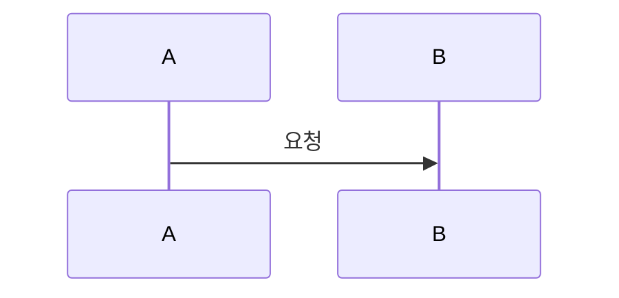

# Plan: SPEC-NNN <기능 이름> — <repo>

- spec: docs 레포 `docs/specs/SPEC-NNN-<slug>/spec.md`
- 계약: docs 레포 `docs/contracts/...`

## 1. 요약
이 레포에서 무엇을 어떻게 구현하는지 3~5줄로 적는다.

## 2. 담당 요구사항
| 요구사항 | 담당 모듈 / 컴포넌트 | 검증 테스트 |
| --- | --- | --- |
| R-1 | services/user-service | `SignUpApiTest` |

## 3. 원칙 점검
| 원칙 | 준수 | 비고 |
| --- | --- | --- |
| I 스펙 우선 — spec이 Approved 상태인가 | ☐ | |
| II 계약 우선 — 계약 변경이 먼저 머지됐는가 | ☐ | |
| III 테스트 우선 — 모든 R-*에 테스트가 매핑되고, 태스크가 요구사항 단위 TDD 사이클로 나뉘었는가 | ☐ | |
| IV 서비스 자율성 — 다른 서비스 DB나 코드에 직접 의존하지 않는가 | ☐ | |
| V 단순성 — 새 의존성이나 추상화가 정당한가 | ☐ | |
| VI 관측 가능성 — 로그, 추적, health를 갖췄는가 | ☐ | |
| VII 보안 — 입력 검증, 인가, 비밀값 처리를 했는가 | ☐ | |
| VIII 문서·주석 — spec·계약·plan과 구현이 일치하고, 주석이 왜를 설명하는가 | ☐ | |
| IX GitOps — AWS 변경은 infra, 클러스터 변경은 gitops 레포를 거치는가 | ☐ | |

## 4. 기술 설계

### 변경 대상
| 경로 | 변경 |
| --- | --- |

### 데이터 모델
테이블, 컬럼, 인덱스 변경과 마이그레이션 파일 이름. 해당이 없으면 "해당 없음".

### API / 이벤트
구현할 operationId 목록과 계약 링크.

### 상호작용

## 5. 대안과 선택 이유
| 대안 | 장점 | 단점 | 선택 |
| --- | --- | --- | --- |

되돌리기 어렵거나 다른 레포에 영향을 주는 결정이라면 ADR로 승격한다.

## 6. 테스트 전략
- 단위:
- 통합:
- E2E / 계약:

## 7. 리스크와 롤백
- 리스크:
- 롤백 방법:

## 8. 배포 고려사항
환경변수 추가(루트 `local/.env.example`, 레포 `.env.example`, gitops 설정 반영), 마이그레이션 순서, 다른 서비스와의 배포 순서, feature flag.
